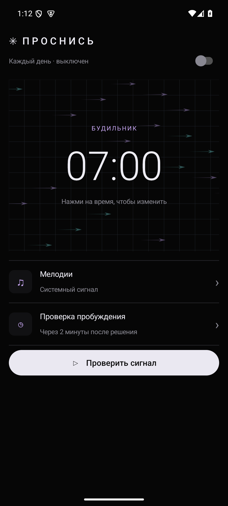
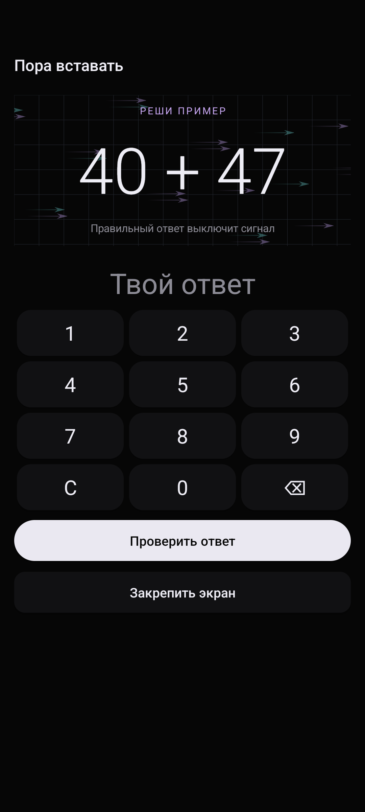

# Проснись

Android-будильник: пользователь выбирает несколько аудиофайлов, и они повторяются одновременно. Для остановки сигнала нужно решить пример на сложение. Через 2 минуты после правильного ответа приходит уведомление; если не подтвердить пробуждение в течение минуты, сигнал звучит снова с новым примером. Будильник повторяется каждый день.

## Сборка

Откройте проект в Android Studio (Android SDK 36, JDK 17) или выполните `./gradlew assembleDebug`. APK: `app/build/outputs/apk/debug/app-debug.apk`. Минимальная версия — Android 8.0.

При первом включении разрешите уведомления, точные будильники и полноэкранные уведомления, если система попросит. Выберите мелодии через системный выбор файлов. Для проверки есть кнопка «Проверить сигнал сейчас». Необходимо протестировать сигнал, экран блокировки и проверку пробуждения на конкретном устройстве. Громкость определяется настройками будильника телефона.

## Ограничения Android

Обычное приложение не может запретить выключение телефона, удаление приложения, переход домой, принудительную остановку или гарантировать показ поверх других приложений при любых настройках. Полноэкранное уведомление может отображаться как обычное, если телефон уже используется. Работа зависит от системных разрешений, режима энергосбережения и поведения производителя. После принудительной остановки приложения, разряда или выключения телефона сигнал не гарантируется. Не используйте приложение как единственный способ проснуться, пока не проверили его на своём устройстве.

Во время сигнала можно нажать «Закрепить экран» и подтвердить системное закрепление. Кнопки навигации скрываются, но остаются доступны системными жестами. Закрепление можно отключить средствами Android; после правильного ответа приложение отключает его само. Экстренный доступ и выключение телефона остаются под контролем Android.

## Установка

[Скачать подписанный APK](https://github.com/Ee1evch/-/raw/refs/heads/main/downloads/prosnis.apk). Версия поддерживает Android 8.0 и новее, независимо от архитектуры процессора. Разрешите установку из выбранного источника в настройках телефона. Некоторые устройства или политики безопасности могут блокировать установку или ограничивать будильники.

SHA-256 APK: `123810efd030ec8e83b8c011a131187d7e6a9e805e2f09ffcbcf1483cc0739bc`. SHA-256 сертификата подписи: `16b16f66132565012b39723da5d9eade48034f2417157f97f6779fcdc93290ad`. APK подписан собственным сертификатом приложения; проверка подписи не означает проверку Google Play Protect. Приватный ключ хранится только на машине сборки и не включён в репозиторий. Для обновления установленной версии следует использовать тот же ключ. Debug-сборки GitHub Actions используют другой сертификат и не обновляют установленную release-сборку.

## Скриншоты

## Версия 1.1

Тёмный интерфейс с анимированным векторным полем, крупными часами, сиреневыми акцентами и цифровой клавиатурой для решения примера. Анимация учитывает системное отключение анимаций. Проверены установка обновления и остановка сигнала правильным ответом в эмуляторе Android 15.

## Версия 1.2

Компактный чёрный интерфейс по референсу AWA: плоская сетка со стрелками, переключатель и строки настроек. Проверка пробуждения фиксирована через 120 секунд после правильного ответа, независимо от старых настроек. На Android 15 уведомление в реальном тесте появилось через 120,7 секунды. На подтверждение остаётся одна минута; без ответа сигнал повторяется.
